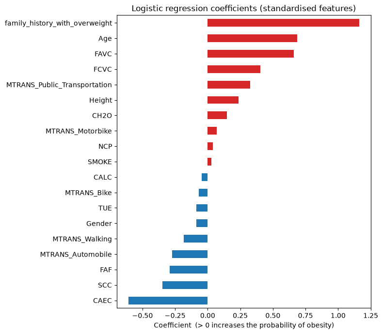
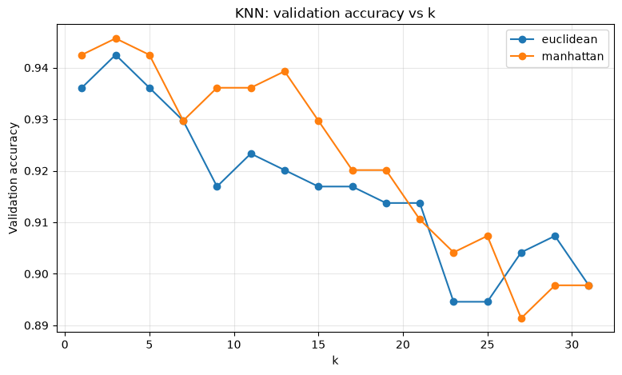
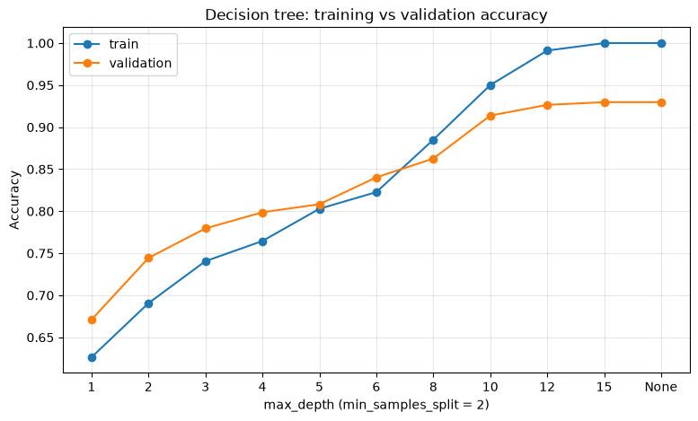
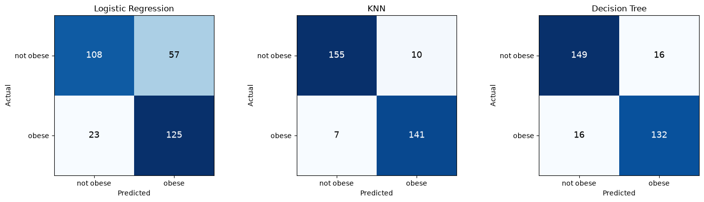

# Obesity Level Estimation — ML Algorithms from Scratch

Classic machine-learning algorithms implemented **from scratch with NumPy** and applied to the
[Estimation of Obesity Levels Based on Eating Habits and Physical Condition](https://archive.ics.uci.edu/dataset/544/estimation+of+obesity+levels+based+on+eating+habits+and+physical+condition)
dataset (UCI). scikit-learn is used only for metrics and to cross-check every from-scratch model against its library counterpart.

Homework for the *Fondamenti di Intelligenza Artificiale* (Foundations of AI) course, B.Sc., A.Y. 2023/24 — revised in 2026.

**Author:** Giorgio Tuccinardi

| Task | Target | From-scratch models |
|---|---|---|
| Regression | `Weight` (kg) | Linear regression (closed form + ridge), linear regression (gradient descent), feed-forward neural network (backprop, mini-batch GD) |
| Binary classification | obese vs. not obese | Logistic regression (GD + L2), K-Nearest Neighbors (Euclidean / Manhattan), decision tree (information gain) |

Every model has documented hyperparameter tuning on a validation set. The full code, explanations and critical analysis are in
[`obesity_ml_from_scratch.ipynb`](obesity_ml_from_scratch.ipynb). The notebook is committed with its outputs, so GitHub shows
it already executed. The walkthrough below is a summary of one run.

---

## Demo: a run of the notebook

### 1. Data

```text
Shape: (2111, 17)
Missing values: 0
Duplicated rows: 24
Shape after removing duplicates: (2087, 17)
```


### 2. Target leakage check

The obesity class was assigned from the BMI (`Weight / Height²`), and the BMI ranges of the classes barely overlap:

```text
                       min    max  count
NObeyesdad
Insufficient_Weight  13.00  19.08    267
Normal_Weight        18.49  24.91    282
Overweight_Level_I   22.83  28.77    276
Overweight_Level_II  25.71  30.36    290
Obesity_Type_I       29.91  35.17    351
Obesity_Type_II      34.05  39.79    297
Obesity_Type_III     36.77  50.81    324

Accuracy of the rule 'BMI >= 30' (no learning at all): 0.9971
```

For this reason `Weight` is excluded from the classification features, and `NObeyesdad` from the regression features.

### 3. Split

```text
train: 1461  validation: 313  test: 313
  obese rate in train     : 0.464
  obese rate in validation: 0.466
  obese rate in test      : 0.473
```

### 4. Regression of `Weight`

**Linear regression, closed form.** Tuning of the ridge penalty λ on the validation set:

```text
lambda =     0.0: validation MSE = 335.401
lambda =     0.1: validation MSE = 335.402
lambda =      10: validation MSE = 335.540
lambda =     100: validation MSE = 338.533
lambda =    1000: validation MSE = 399.432

Best lambda: 0.0
Max |difference| between scratch and sklearn predictions: 5.4e-13
```


**Linear regression, gradient descent.** Grid search on learning rate × iterations:

```text
 learning_rate  iterations  train_cost  val_MSE
         0.001         100    3382.898 6894.725
         0.001        1000     677.071 1490.269
         0.001        5000     148.769  339.429
         0.010        1000     147.845  335.593
         0.100        1000     147.799  335.401
         0.300        1000     147.799  335.401

Best: learning_rate=0.3, iterations=1000
Max |theta_GD - w_closed_form(lambda=0)|: 0.00039
```


**Neural network (MLP).** Gradient check, then grid search over 24 configurations (top 3 shown):

```text
Max relative error between analytical and numerical gradients: 3.24e-08

hidden_layers  learning_rate  epochs    l2  val_MSE
     (64, 32)          0.020     150 0.001  103.735
     (64, 32)          0.020     150 0.000  105.630
     (64, 32)          0.020      50 0.001  122.904
```


**Regression results (test set):**

```text
                                    MSE    RMSE     MAE     R2
Baseline (mean)                 628.768  25.075  20.698 -0.001
Linear Reg. (closed form)       322.879  17.969  13.970  0.486
Linear Reg. (sklearn check)     322.879  17.969  13.970  0.486
Linear Reg. (gradient descent)  322.879  17.969  13.970  0.486
Neural Network                  146.710  12.112   7.359  0.767
Neural Network (sklearn check)  138.297  11.760   6.639  0.780
```

### 5. Classification: obese vs. not obese

```text
Majority-class accuracy on test: 0.5272
```

**Logistic regression.** Grid search on learning rate × iterations × L2, then the learned coefficients:

```text
 learning_rate  n_iterations   l2  val_accuracy  val_log_loss
          0.10           500  0.0        0.8307        0.4176
          0.01          5000  0.0        0.8307        0.4177
          0.10           500  1.0        0.8307        0.4179

Prediction agreement scratch vs sklearn: 0.9968
```



**K-Nearest Neighbors.** Tuning of k and of the distance metric:

```text
Best: k=3, metric=manhattan, validation accuracy=0.9457
Prediction agreement scratch vs sklearn: 1.0
```



**Decision tree.** Tuning of `max_depth` × `min_samples_split` (top 3 shown):

```text
 max_depth  min_samples_split  n_nodes  train_accuracy  val_accuracy
        15                 10      191        0.967830      0.939297
        12                 10      185        0.966461      0.936102
        15                  2      263        1.000000      0.929712

Best: max_depth=15, min_samples_split=10
Prediction agreement scratch vs sklearn: 1.0
Root split feature: family_history_with_overweight
```



**Classification results (test set):**

```text
                                     Accuracy  Precision  Recall      F1
Logistic Regression                    0.7444     0.6868  0.8446  0.7576
Logistic Regression (sklearn check)    0.7412     0.6851  0.8378  0.7538
KNN                                    0.9457     0.9338  0.9527  0.9431
KNN (sklearn check)                    0.9457     0.9338  0.9527  0.9431
Decision Tree                          0.8978     0.8919  0.8919  0.8919
Decision Tree (sklearn check)          0.8978     0.8919  0.8919  0.8919
```



### 6. How much does leakage inflate the results?

The same models are retrained with the leaking feature put back (`Weight` for the classifiers, `NObeyesdad` for the regression):

```text
                                    metric  correct setup  with leaking feature
Logistic Regression               accuracy         0.7444                0.9808
KNN                               accuracy         0.9457                0.9712
Decision Tree                     accuracy         0.8978                0.9936
Linear Regression (closed form)  RMSE [kg]        17.9688                5.3616
```

### 7. Final comparison


---

## Key takeaways

- The **neural network** is the best regressor (R² 0.77 vs 0.49 for linear regression): weight depends on lifestyle attributes
  in a non-linear way.
- **KNN** is the best classifier (94.6% accuracy). Part of its advantage comes from the dataset itself: 77% of the records were
  generated with SMOTE, which interpolates between neighbouring points.
- **Logistic regression** is limited by its linear decision boundary (74.4%), but it is the most interpretable model.
- The from-scratch KNN, decision tree and linear regression give exactly the same predictions as scikit-learn. Logistic
  regression and the MLP get very close results.

The full discussion is in the *Critical analysis* section of the notebook.

## How to run

```bash
python -m venv .venv
# Windows: .venv\Scripts\activate    Linux/macOS: source .venv/bin/activate
pip install -r requirements.txt
jupyter notebook obesity_ml_from_scratch.ipynb
```

The whole notebook runs in about 20 seconds, and results are reproducible (fixed seed 42). After re-running it,
`python tools/export_figures.py` regenerates the images used in this README.

## Repository structure

```
.
├── obesity_ml_from_scratch.ipynb   # the notebook (executed, with outputs)
├── data/ObesityDataSet.csv         # dataset (UCI id 544, CC BY 4.0)
├── images/                         # figures exported from the notebook
├── tools/export_figures.py         # regenerates images/ from the notebook
├── requirements.txt
└── README.md
```

## Changes from the original 2024 submission

- **Target leakage removed.** The original reported 100% classification accuracy because `Height` and `Weight` were both inputs.
- **Proper train / validation / test split** (70/15/15). Hyperparameters used to be chosen on the test set.
- **Standardisation fitted on the training set only.** Before, the test set was standardised with its own statistics.
- **Bugs fixed.** Logistic regression grid search returned the weights of the last combination instead of the best one.
  The neural network applied ReLU to its regression output. KNN used unscaled features.
- **Better encoding.** Ordinal attributes (`CAEC`, `CALC`) are now encoded as ordered integers. Duplicate records are removed.
- **More tuning and checks.** Ridge penalty, L2 for logistic regression, KNN distance metric, `min_samples_split` for the tree.
  Added a gradient check for backpropagation, baselines, and precision / recall / F1 / confusion matrices.
- **Faster code.** KNN distances are vectorised and the tree's split search is vectorised (seconds instead of minutes).
- **Reproducibility.** Fixed seed, local copy of the dataset, translated to English.

## Dataset

Palechor, F. M., & de la Hoz Manotas, A. (2019). *Dataset for estimation of obesity levels based on eating habits and physical
condition in individuals from Colombia, Peru and Mexico.* Data in Brief, 25. Distributed by the UCI Machine Learning Repository
under the [CC BY 4.0](https://creativecommons.org/licenses/by/4.0/) license.
