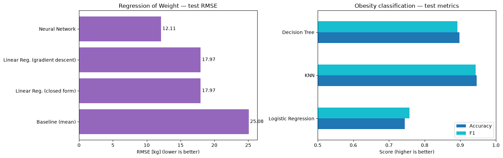
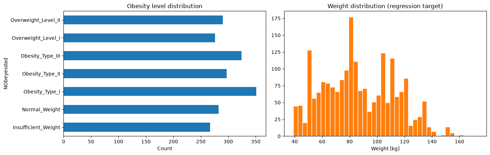
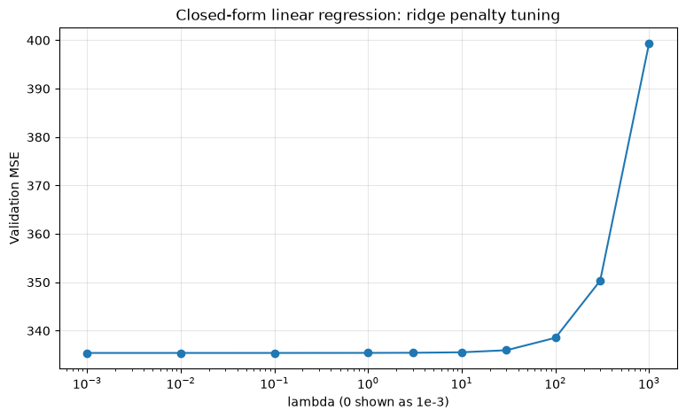
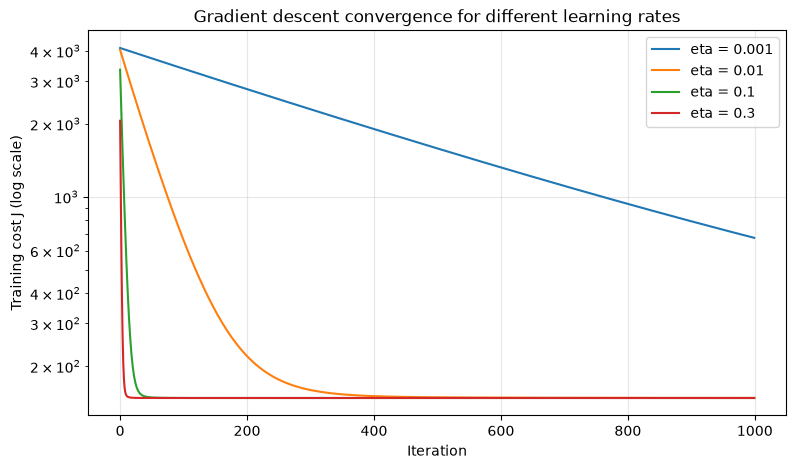
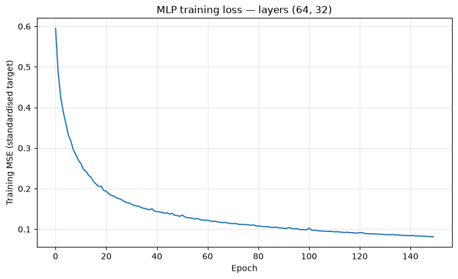

# Obesity Level Estimation — ML Algorithms from Scratch

[](https://colab.research.google.com/github/GiorgioTuk/obesity-ml-from-scratch/blob/main/obesity_ml_from_scratch.ipynb)


Six classic machine-learning algorithms **implemented from first principles with NumPy**, evaluated on a real dataset with a
sound methodology. The project also detects and measures a **target-leakage** problem hidden in the data.

**Author:** Giorgio Tuccinardi

## Goal

Understand how core ML algorithms work by building them without ML libraries, and evaluate them the way it is done in
practice:

- **From scratch:** linear regression (closed form and gradient descent), a neural network with backpropagation, logistic
  regression, K-Nearest Neighbors and a decision tree, all written with NumPy only.
- **Verified:** each model is checked against its scikit-learn counterpart. KNN, the decision tree and linear regression give
  identical predictions. The backpropagation gradients match a numerical gradient check.
- **Sound evaluation:** train / validation / test split, pre-processing fitted on training data only, and hyperparameter tuning
  on the validation set. The test set is used once, at the end.
- **Data-aware:** the obesity label turns out to be a function of the BMI, so features that leak it are identified and removed.

Dataset: [Estimation of Obesity Levels Based on Eating Habits and Physical Condition](https://archive.ics.uci.edu/dataset/544/estimation+of+obesity+levels+based+on+eating+habits+and+physical+condition)
(UCI, 2111 people from Mexico, Peru and Colombia, 17 attributes). Two tasks: predict **`Weight`** (regression) and predict
whether a person is **obese** (binary classification) from lifestyle and personal attributes.

## Results at a glance



| Regression of `Weight` (test set) | RMSE [kg] | MAE [kg] | R² |
|---|---|---|---|
| Baseline (predict the mean) | 25.08 | 20.70 | 0.00 |
| Linear regression (closed form = gradient descent) | 17.97 | 13.97 | 0.49 |
| **Neural network** (64-32, ReLU) | **12.11** | **7.36** | **0.77** |

| Obesity classification (test set) | Accuracy | F1 |
|---|---|---|
| Baseline (majority class) | 0.527 | — |
| Logistic regression | 0.744 | 0.758 |
| Decision tree (max_depth 15, min_samples_split 10) | 0.898 | 0.892 |
| **KNN** (k = 3, Manhattan) | **0.946** | **0.943** |

**Key findings**
- The **neural network** clearly beats linear regression (R² 0.77 vs 0.49): weight depends on lifestyle in a non-linear way.
- **KNN** is the best classifier. Part of its advantage comes from the data: 77% of the records were synthetically generated
  with SMOTE, which interpolates between neighbouring points and favours neighbourhood-based methods.
- **Logistic regression** is limited by its linear decision boundary, but it is the most interpretable model. Its
  coefficients show which habits increase the estimated probability of obesity.

## The leakage trap

The obesity classes were assigned from the BMI (`Weight / Height²`). A single fixed rule, `BMI >= 30`, already reaches
**99.7% accuracy** without learning anything. With `Weight` among the inputs, every classifier would look nearly perfect while
learning nothing about eating habits:

| Model | Correct setup | With the leaking feature |
|---|---|---|
| Logistic regression (accuracy) | 0.744 | 0.981 |
| KNN (accuracy) | 0.946 | 0.971 |
| Decision tree (accuracy) | 0.898 | 0.994 |
| Linear regression (RMSE, kg) | 17.97 | 5.36 |

So `Weight` is excluded from the classification features, and the obesity class from the regression features.

## Demo: a run of the notebook

Terminal output and figures from one execution, section by section. Click a section to expand it.

<details>
<summary><b>1. Data</b></summary>

```text
Shape: (2111, 17)
Missing values: 0
Duplicated rows: 24
Shape after removing duplicates: (2087, 17)
```



</details>

<details>
<summary><b>2. Target leakage check</b></summary>

The obesity class was assigned from the BMI (`Weight / Height²`), and the BMI ranges of the classes barely overlap:

```text
                       min    max  count
NObeyesdad
Insufficient_Weight  13.00  19.08    267
Normal_Weight        18.49  24.91    282
Overweight_Level_I   22.83  28.77    276
Overweight_Level_II  25.71  30.36    290
Obesity_Type_I       29.91  35.17    351
Obesity_Type_II      34.05  39.79    297
Obesity_Type_III     36.77  50.81    324

Accuracy of the rule 'BMI >= 30' (no learning at all): 0.9971
```

For this reason `Weight` is excluded from the classification features, and `NObeyesdad` from the regression features.

</details>

<details>
<summary><b>3. Split</b></summary>

```text
train: 1461  validation: 313  test: 313
  obese rate in train     : 0.464
  obese rate in validation: 0.466
  obese rate in test      : 0.473
```

</details>

<details>
<summary><b>4. Regression of <code>Weight</code></b></summary>

**Linear regression, closed form.** Tuning of the ridge penalty λ on the validation set:

```text
lambda =     0.0: validation MSE = 335.401
lambda =     0.1: validation MSE = 335.402
lambda =      10: validation MSE = 335.540
lambda =     100: validation MSE = 338.533
lambda =    1000: validation MSE = 399.432

Best lambda: 0.0
Max |difference| between scratch and sklearn predictions: 5.4e-13
```



**Linear regression, gradient descent.** Grid search on learning rate × iterations:

```text
 learning_rate  iterations  train_cost  val_MSE
         0.001         100    3382.898 6894.725
         0.001        1000     677.071 1490.269
         0.001        5000     148.769  339.429
         0.010        1000     147.845  335.593
         0.100        1000     147.799  335.401
         0.300        1000     147.799  335.401

Best: learning_rate=0.3, iterations=1000
Max |theta_GD - w_closed_form(lambda=0)|: 0.00039
```



**Neural network (MLP).** Gradient check, then grid search over 24 configurations (top 3 shown):

```text
Max relative error between analytical and numerical gradients: 3.24e-08

hidden_layers  learning_rate  epochs    l2  val_MSE
     (64, 32)          0.020     150 0.001  103.735
     (64, 32)          0.020     150 0.000  105.630
     (64, 32)          0.020      50 0.001  122.904
```



**Regression results (test set):**

```text
                                    MSE    RMSE     MAE     R2
Baseline (mean)                 628.768  25.075  20.698 -0.001
Linear Reg. (closed form)       322.879  17.969  13.970  0.486
Linear Reg. (sklearn check)     322.879  17.969  13.970  0.486
Linear Reg. (gradient descent)  322.879  17.969  13.970  0.486
Neural Network                  146.710  12.112   7.359  0.767
Neural Network (sklearn check)  138.297  11.760   6.639  0.780
```

</details>

<details>
<summary><b>5. Classification: obese vs. not obese</b></summary>

```text
Majority-class accuracy on test: 0.5272
```

**Logistic regression.** Grid search on learning rate × iterations × L2, then the learned coefficients:

```text
 learning_rate  n_iterations   l2  val_accuracy  val_log_loss
          0.10           500  0.0        0.8307        0.4176
          0.01          5000  0.0        0.8307        0.4177
          0.10           500  1.0        0.8307        0.4179

Prediction agreement scratch vs sklearn: 0.9968
```


**K-Nearest Neighbors.** Tuning of k and of the distance metric:

```text
Best: k=3, metric=manhattan, validation accuracy=0.9457
Prediction agreement scratch vs sklearn: 1.0
```


**Decision tree.** Tuning of `max_depth` × `min_samples_split` (top 3 shown):

```text
 max_depth  min_samples_split  n_nodes  train_accuracy  val_accuracy
        15                 10      191        0.967830      0.939297
        12                 10      185        0.966461      0.936102
        15                  2      263        1.000000      0.929712

Best: max_depth=15, min_samples_split=10
Prediction agreement scratch vs sklearn: 1.0
Root split feature: family_history_with_overweight
```


**Classification results (test set):**

```text
                                     Accuracy  Precision  Recall      F1
Logistic Regression                    0.7444     0.6868  0.8446  0.7576
Logistic Regression (sklearn check)    0.7412     0.6851  0.8378  0.7538
KNN                                    0.9457     0.9338  0.9527  0.9431
KNN (sklearn check)                    0.9457     0.9338  0.9527  0.9431
Decision Tree                          0.8978     0.8919  0.8919  0.8919
Decision Tree (sklearn check)          0.8978     0.8919  0.8919  0.8919
```


</details>

<details>
<summary><b>6. How much does leakage inflate the results?</b></summary>

The same models are retrained with the leaking feature put back (`Weight` for the classifiers, `NObeyesdad` for the regression):

```text
                                    metric  correct setup  with leaking feature
Logistic Regression               accuracy         0.7444                0.9808
KNN                               accuracy         0.9457                0.9712
Decision Tree                     accuracy         0.8978                0.9936
Linear Regression (closed form)  RMSE [kg]        17.9688                5.3616
```

</details>

## Notebook vs README

- **This README** is the overview: goal, results, and a walkthrough of one run.
- **[The notebook](obesity_ml_from_scratch.ipynb)** is the full technical document. It contains the theory behind each
  algorithm (formulas included), all the code, every output and the complete critical analysis. GitHub shows it already
  executed, and the *Open in Colab* badge runs it in the browser without installing anything.

## How to run

**In the browser:** click *Open in Colab* above, then *Runtime → Run all*. The dataset is downloaded automatically.

**Locally:**

```bash
python -m venv .venv
# Windows: .venv\Scripts\activate    Linux/macOS: source .venv/bin/activate
pip install -r requirements.txt
jupyter notebook obesity_ml_from_scratch.ipynb
```

The whole notebook runs in about 20 seconds, and results are reproducible (fixed seed 42). After re-running it,
`python tools/export_figures.py` regenerates the images used in this README.

## Repository structure

```
.
├── obesity_ml_from_scratch.ipynb   # full notebook: theory, code, outputs, critical analysis
├── data/ObesityDataSet.csv         # dataset (UCI id 544, CC BY 4.0)
├── images/                         # figures exported from the notebook
├── tools/export_figures.py         # regenerates images/ from the executed notebook
├── requirements.txt
└── README.md
```

## Project history

This project started as a homework for the *Foundations of AI* course (B.Sc., A.Y. 2023/24). In 2026 I revised and
extended it:

- found and removed the target leakage, which made the original version report 100% classification accuracy;
- introduced a train / validation / test split, so hyperparameters are no longer chosen on the test set;
- fitted standardisation on the training set only;
- fixed bugs: logistic-regression grid search kept the last weights instead of the best ones, the neural network applied ReLU
  to its regression output, and KNN used unscaled features;
- encoded ordinal attributes as ordered integers and removed duplicate records;
- widened the hyperparameter search (ridge penalty, L2, KNN distance metric, tree pre-pruning);
- added baselines, a numerical gradient check, and precision / recall / F1 / confusion matrices;
- vectorised KNN and the decision-tree split search, so tuning takes seconds instead of minutes.

## Dataset

Palechor, F. M., & de la Hoz Manotas, A. (2019). *Dataset for estimation of obesity levels based on eating habits and physical
condition in individuals from Colombia, Peru and Mexico.* Data in Brief, 25. Distributed by the UCI Machine Learning Repository
under the [CC BY 4.0](https://creativecommons.org/licenses/by/4.0/) license.
